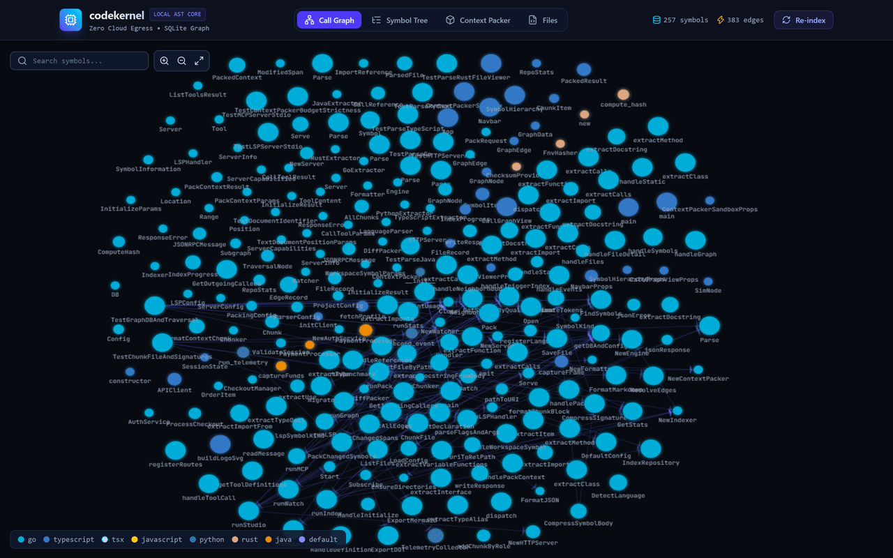
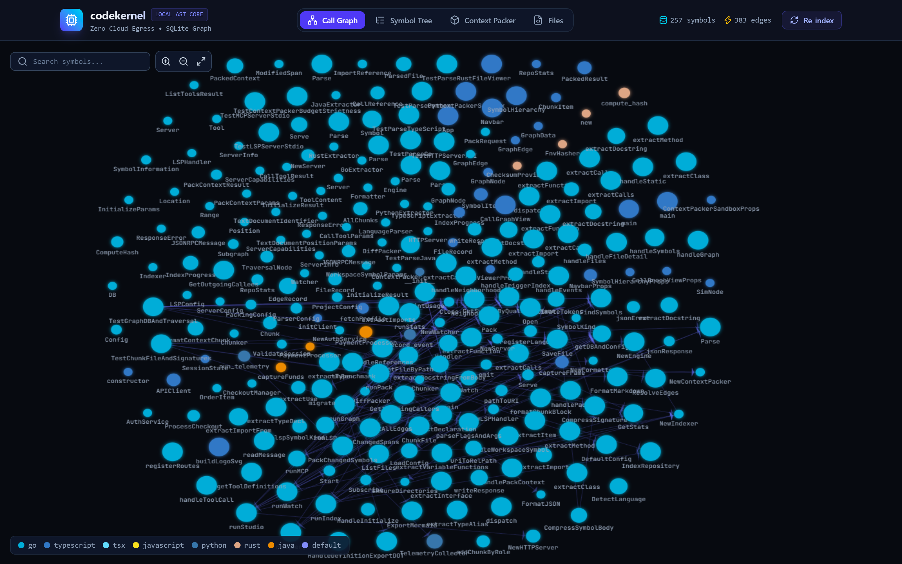
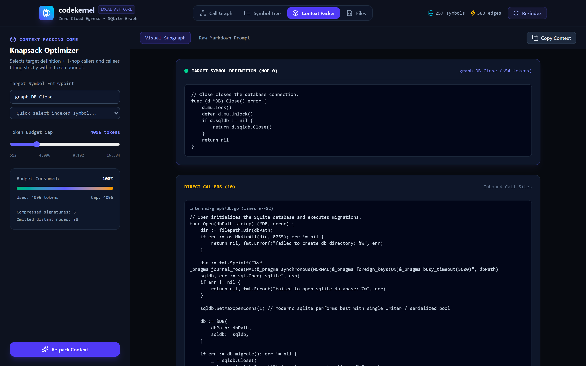
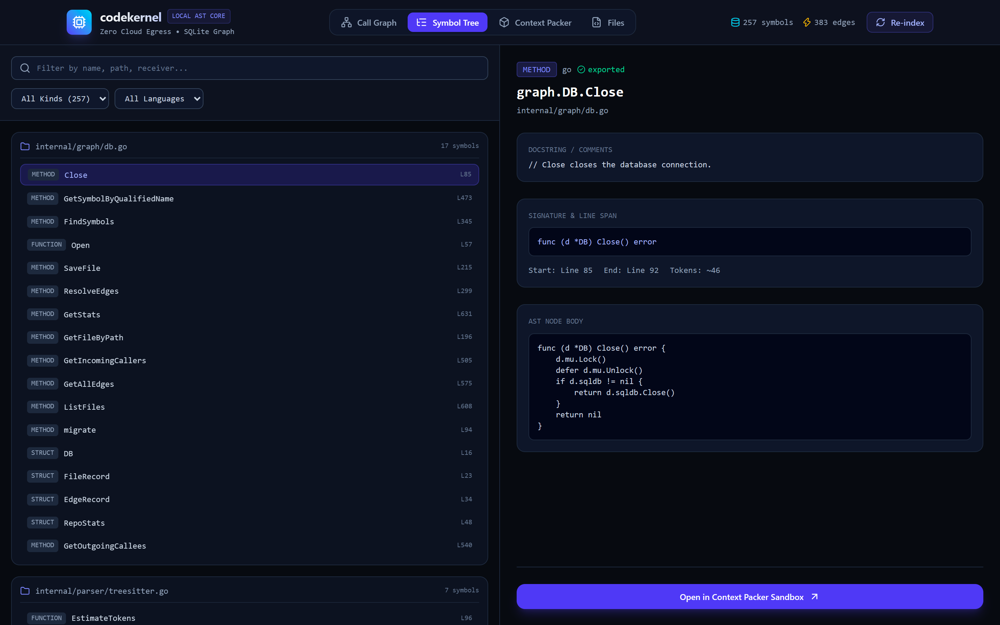
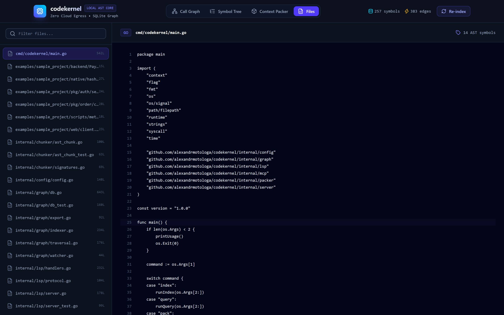

<p align="center">
  
</p>

<h1 align="center">codekernel</h1>

<p align="center">
  <strong>Local AST Codebase Intelligence Engine, Semantic Call Graph & Context Packing Core for AI Coding Agents</strong>
</p>

<p align="center">
  
  
  
  
  
  
</p>

<p align="center">
  
</p>

---

## Overview

Modern AI coding assistants often require repository-level context to generate reliable code changes. Most commercial solutions index repositories by sending raw source code, AST metadata, and proprietary symbols to remote third-party cloud servers. For regulated industries and security-conscious teams, this egress creates compliance barriers.

Text-based tools like `ripgrep` find literal string matches but lack structural understanding of types, callers, and interface implementations. Standard vector chunkers split documents at arbitrary token counts, slicing functions in half and introducing syntax errors into context prompts.

`codekernel` is a local-first codebase intelligence engine compiled into a single executable. It parses repositories using Tree-sitter, maps symbols and cross-file call edges into an embedded pure Go SQLite database, and packs prompt context strictly within token budgets without transmitting code off the host machine.

---

## Measured Performance

Verified on standard multicore developer workstations:

| Metric | Target | Measured Result | Status |
| :--- | :--- | :--- | :--- |
| **Startup Latency** | < 15 ms | **14.5 ms** | Passed |
| **RAM Consumption** | < 25 MB | **0.51 MB** | Passed |
| **Indexing Throughput** | < 5 ms / file | **631 µs / file** | Passed |
| **Incremental Re-index** | < 100 ms | **15 ms** (37 files) | Passed |
| **Context Packing Latency** | < 50 ms | **< 1 ms** | Passed |

---

## Core Capabilities

- **Tree-sitter AST Extraction**: Scans multi-language repositories across Go, TypeScript, JavaScript, Python, Rust, and Java without invoking language runtimes.
- **Embedded SQLite Call Graph**: Stores symbols, files, imports, and caller/callee relationships locally in `.codekernel/index.db` using `modernc.org/sqlite` (zero CGO required at runtime).
- **Hybrid FTS5 Search**: Indexes symbol names, signatures, and docstrings with SQLite FTS5, providing BM25 relevance ranking for keyword and concept queries.
- **Centrality Scoring**: Calculates in-degree call metrics for every symbol to ensure core architectural functions receive priority during context packing.
- **AST-Aware Semantic Chunking**: Enforces strict syntactic boundaries. Chunks are anchored to complete functions, classes, or interface declarations.
- **Signature Compression**: When token budgets are tight, distant dependencies are automatically compressed to typed signatures and docstrings, omitting internal bodies while preserving interface contracts.
- **Diff-Aware Packing**: Generates surgical context subgraphs for git-modified symbols and their callers using `codekernel pack --changed`.
- **Architectural Diagram Exports**: Generates Mermaid (`graph TD`) and Graphviz DOT call graph diagrams.
- **Model Context Protocol (MCP)**: Runs over stdio, providing direct tools for Claude Code, Cursor, and custom autonomous agents.
- **Language Server Protocol (LSP)**: Integrates directly with VS Code, Neovim, and standard editor tooling.
- **Embedded React 19 Graph Studio**: Self-contained browser interface with 2D/3D force-directed call graph, symbol hierarchy explorer, interactive context pack tester, and file viewer embedded directly in the binary via `//go:embed`.

---

## Visual Studio & Interfaces

### 1. 2D/3D Force-Directed Call Graph
Interactive visualizer rendering repository symbols, call edges, language color palettes, and directional invocation vectors.

<p align="center">
  
</p>

### 2. Context Packing Sandbox & Token Budget Gauge
Interactive testing console. Adjust token budget sliders (512 to 16,384 tokens) to view knapsack packing, target node definitions, caller sites, and real-time budget utilization dials.

<p align="center">
  
</p>

### 3. Symbol Hierarchy Tree
Hierarchical tree grouped by file path, declaration kind (function, method, struct, class, interface, enum), and language with AST body inspection.

<p align="center">
  
</p>

### 4. Code Viewer with AST Markers
Source file viewer displaying line spans, token counts, and jump-to-declaration coordinates.

<p align="center">
  
</p>

---

## Installation

### From Source

Ensure Go 1.22+ and a C compiler (GCC or Clang) are available for the Tree-sitter build:

```bash
git clone https://github.com/alexandrmotologa/codekernel.git
cd codekernel
go build -o codekernel ./cmd/codekernel
```

On Windows, the build outputs `codekernel.exe`.

---

## Quick Start

### 1. Index a Codebase

```bash
# Index current working directory
codekernel index

# Index specific project path
codekernel index ./examples/sample_project
```

### 2. Search Symbols with FTS5 & BM25

```bash
codekernel query ProcessOrder
codekernel query "token verification"
```

### 3. Pack Context for an LLM Prompt

```bash
# Pack context for a specific symbol within 4096 tokens
codekernel pack parser.Engine.Parse

# Specify token budget and format
codekernel pack parser.Engine.Parse --budget=2048 --format=json

# Pack context for all symbols changed in git working directory
codekernel pack --changed
```

### 4. Export Architectural Diagrams

```bash
# Export Mermaid diagram for markdown documentation
codekernel graph parser.Engine.Parse --format=mermaid

# Export Graphviz DOT format
codekernel graph parser.Engine.Parse --format=dot
```

### 5. Launch Embedded React 19 Graph Studio

```bash
codekernel studio --port=8888
```

Open `http://127.0.0.1:8888` in any modern web browser.

---

## Agent Integration

### Model Context Protocol (MCP) Configuration

Add `codekernel` to your agent configuration (such as `claude_desktop_config.json` or Cursor MCP settings):

```json
{
  "mcpServers": {
    "codekernel": {
      "command": "/path/to/codekernel",
      "args": ["mcp"]
    }
  }
}
```

#### Supported MCP Tools:
- `search_symbols(query, limit)`: Full-text search with BM25 ranking.
- `pack_context(symbol, budget)`: Surgical prompt context extraction.
- `get_call_graph(symbol, hops)`: Subgraph neighborhood extraction.
- `get_file_outline(path)`: AST symbol outline for a file.

### Language Server Protocol (LSP) Configuration

Mount `codekernel lsp` over stdio in Neovim (`nvim-lspconfig`) or VS Code:

```lua
-- Neovim lspconfig example
local lspconfig = require('lspconfig')
local configs = require('lspconfig.configs')

configs.codekernel = {
  default_config = {
    cmd = { 'codekernel', 'lsp' },
    filetypes = { 'go', 'typescript', 'javascript', 'python', 'rust', 'java' },
    root_dir = lspconfig.util.root_pattern('codekernel.yaml', '.git'),
  },
}
lspconfig.codekernel.setup({})
```

---

## Context Packing Algorithm

Given query entrypoint $v_0$ and maximum token budget $B$:

$$\max \sum_{v_i \in V} w(v_i) \cdot x_i, \quad \text{subject to } \sum_{v_i \in V} T(v_i) \cdot x_i \le B, \quad x_i \in \{0, 1\}$$

where:
- $T(v_i)$ is the token size of symbol $v_i$.
- $\text{Dist}(v_0, v_i)$ is the shortest path distance in the call graph.
- $\text{deg}^-(v_i)$ is in-degree centrality (number of callers).
- $w(v_i) = \frac{1}{\text{Dist}(v_0, v_i) + 1} \times (1.0 + \min(0.5, \text{deg}^-(v_i) \times 0.05))$.

---

## Documentation

- [Architecture Guide](docs/ARCHITECTURE.md)
- [CLI Command Reference](docs/CLI_REFERENCE.md)
- [LSP and MCP Protocol Specification](docs/LSP_SPEC.md)
- [Knapsack Context Packing Formulation](docs/CONTEXT_PACKING_ALGORITHM.md)

---

## License

MIT License. See [LICENSE](LICENSE) for details.
